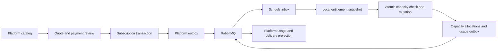

# الخطة التقنية للأنظمة والباقات والاشتراكات والسعات

التاريخ: 2026-10-15  
الحالة: خطة للتنفيذ؛ لم تُطبّق تغييرات هذا المستند على التطبيق أو قواعد البيانات.  
مرجع المتطلبات: ADR-058 في `docs/project-history/DECISIONS.md`.

## 1. الهدف والنتيجة المطلوبة

استبدال نموذج `UnitType / UnitPurchaseIntent / UnitGrant` بنموذج تعاقد على أنظمة كاملة، وباقات ذات سعات محددة، وإضافات وترقيات. تدير Platform الأنظمة وإتاحاتها والباقات وأسعارها وترتيبها، وتطبق Schools الاستفادة والسعة محليًا.

الأرقام السابقة الخاصة بالأسعار والسعات أمثلة تجارية فقط. لا تثبت أسعار الطلاب أو الموظفين أو الخزن أو أحجام الباقات في الكود.

### 1.1 المتطلبات المحسومة

| المتطلب | السلوك المطلوب |
|---|---|
| الأنظمة | تعريفها وإدارة إتاحاتها من Platform؛ البداية أكاديمي وإداري ومالي |
| الإتاحات | وظائف النظام تتاح تلقائيًا بالاشتراك فيه، مع استمرار صلاحيات المستخدمين |
| الباقات | قابلة للتخصيص داخل كل نظام، بسعة وسعر فرد وسعر إضافة وترتيب |
| السعة | يدفع العميل قيمة الباقة الكاملة سواء استهلكها أم لا |
| سعر الباقة | `Capacity × BaseUnitPrice` |
| سعر الإضافات | `AdditionalQuantity × AddOnUnitPrice` |
| الترتيب | محدد داخل النظام؛ يستخدم لعرض الباقات التالية والترقية |
| الاستهلاك | تفعيل الشخص المحتسب يستهلك مقعدًا؛ شراء الإضافة يزيد الحد |
| الأكاديمي | يقاس بالطلاب؛ يتيح موظفي ومدرسي التشغيل دون اشتراط شراء الإداري |
| الإداري | يقاس بالموظفين المستفيدين إداريًا، وليس بمجرد عدد حسابات الدخول |
| المالي | يقاس بالخزن وفق تعريفها التجاري المعتمد |
| الإلغاء | إزالة تجربة الوحدات القديمة واعتمادها التشغيلي بعد ترحيل البيانات |

### 1.2 حدود الوظائف بين الأنظمة

| الوظيفة | النظام المطلوب |
|---|---|
| الطلاب والقبول والقيد والحضور والتقييم والأنشطة | الأكاديمي |
| المدرسون وحساباتهم والإسنادات اللازمة لتشغيل الدراسة | الأكاديمي، دون مقاعد إدارية تلقائية |
| تعريف رسوم الصفوف وخطة الأقساط وطرق السداد | الأكاديمي، عند تنفيذ هذه الوظائف |
| إدارة عقود الموظفين والحضور والإجازات وحساب المرتبات | الإداري، عند تنفيذ HR |
| تسجيل التحصيلات والاستردادات والتسويات والصرف | المالي، مع الخزنة والصلاحيات اللازمة |
| تسجيل صرف المرتبات | المالي؛ وجود راتب محسوب في الإداري لا ينشئ صرفًا تلقائيًا |

لا يشترط الاشتراك في الأنظمة الثلاثة معًا. كل عملية تعتمد على سجل من نظام آخر تتحقق من وجوده وصلاحية استخدامه دون دمج تراخيص الأنظمة.

## 2. قرارات يجب حسمها قبل الأجزاء المعتمدة عليها

يمكن البدء بكتالوج الأنظمة والباقات قبل حسم جميع السياسات. لا يبدأ تفعيل عقود إنتاج أو ترحيلها بسياسات ضمنية.

| الرمز | القرار المفتوح | الجزء الذي يعتمد عليه |
|---|---|---|
| P01 | شهرية أم سنوية أم مدة قابلة للاختيار، وتحديد بداية العقد ونهايته | التسعير والعقود والتجديد |
| P02 | هل تعطيل/انسحاب الشخص يعيد المقعد؟ أم يحسب الفرد طوال مدة العقد؟ | تخصيص السعة وإعادة التفعيل |
| P03 | هل العدد داخل فترة العقد أم العام الدراسي؟ وكيف يتعامل مع ترحيل الأعوام؟ | تعريف الاستخدام والتهيئة |
| P04 | هل العقد للمدرسة المرجعية بكل فروعها أم لنطاق أصغر؟ | مفاتيح السعة ونطاق الترخيص |
| P05 | نقطة تفعيل الطالب: القيد النشط الحالي أم تفعيل تجاري مستقل؟ | إضافة الطالب وقبول الطلب |
| P06 | تعريف الموظف المستفيد إداريًا، ومن يفعّله | تكامل HR وحساب الاستخدام |
| P07 | ما الذي يعد خزنة؟ وهل تشمل البنوك والمحافظ؟ ومصير الخزنة المؤرشفة | المالي ومقياس الخزن |
| P08 | مدة الإضافة وسعرها إذا اشتريت أثناء العقد أو بعد تغير الكتالوج | الإضافات والتجديد |
| P09 | حساب فرق الترقية وتاريخها، ومصير الإضافات القديمة، وإمكانية تخطي أكثر من باقة | عروض الترقية وتنفيذها |
| P10 | سلوك الانتهاء والإيقاف: القراءة، التعديل، المهلة، التصدير | حماية API ودورة العقد |
| P11 | التعامل مع مدرسة موجودة أعلى من السعة الجديدة أو عند تخفيض العقد | الترحيل والتخفيض |
| P12 | أثر تعديل إتاحات النظام على العقود الحالية وموعد سريانه | إصدار الإتاحات والمزامنة |

توصية تصميم: يسجل العقد نسخة من العرض الذي وافق عليه العميل، وتصدر التغييرات اللاحقة كتعديلات صريحة. هذا لا يمنع إدارة أسعار الكتالوج أو تعريف باقات جديدة من Platform. سياسة تطبيق التغييرات على عقد قائم تعتمد ضمن P08/P09/P12.

## 3. الوضع الحالي ونقاط التغيير المؤكدة

الجدول التالي مبني على مراجعة المصدر؛ الأسماء الجديدة في الأقسام اللاحقة مقترحة.

| المكان الحالي | الاعتماد الموجود | التغيير المخطط |
|---|---|---|
| `src/Platform/Mdaresna.Platform.Domain/Billing/Units/UnitType.cs` | تعريف الوحدة والسعر | استبداله بكتالوج الأنظمة والباقات وإصداراتها |
| `.../Billing/Units/UnitPurchaseIntent.cs` و`UnitGrant.cs` | طلب شراء ومنحة وحدات | طلب اشتراك/تعديل مع أثر مالي وسعة واضحة |
| `src/Platform/Mdaresna.Platform.Application/Billing/Units/` | أوامر شراء وإدارة الوحدات | حالات استخدام الكتالوج والعقود والعروض والإضافات |
| `src/Platform/Mdaresna.Platform.Application/Billing/ReviewSchoolPlatformPayment/ReviewSchoolPlatformPaymentCommandHandler.cs` | اعتماد الدفع ينشئ ledger ومنحة وحدات وOutbox | الاحتفاظ بالحكم المالي وإصدار تعديل الاشتراك مرة واحدة |
| `src/Platform/Mdaresna.Platform.Api/Controllers/Billing/UnitTypesController.cs` و`UnitPurchasesController.cs` | API الوحدات | API الكتالوج والاشتراكات؛ إيقاف القديم بعد الترحيل |
| `src/Platform/Mdaresna.Platform.Domain/Registry/SchoolRegistration.cs` | `UnitTypeId` عند اعتماد المدرسة | فصل اعتماد المدرسة وتجهيزها عن اشتراكاتها |
| `src/Platform/Mdaresna.Platform.Api/Controllers/Registry/SchoolsController.cs` | موافقة وفلاتر وقراءات الوحدة | اختيار العقود والباقات وملخص الاشتراكات |
| `src/Schools/Mdaresna.Schools.Contracts/Provisioning/ProvisionSchoolV1.cs` | الوحدة وسعرها جزء من الرسالة | عقد تجهيز بإصدار جديد لا يشترط وحدة |
| `src/Schools/Mdaresna.Schools.Infrastructure/Messaging/SchoolProvisioningConsumerService.cs` | تمرير الوحدة إلى معلومات المدرسة | تطبيق التجهيز الجديد مع توافق مؤقت |
| `src/Schools/Mdaresna.Schools.Domain/School/SchoolInformation.cs` | مرجع الوحدة والاسم والسعر | معلومات المدرسة مستقلة عن السعات التجارية |
| `src/Schools/Mdaresna.Schools.Infrastructure/Persistence/SchoolIdentityConfigurations.cs` | أعمدة الوحدة ضمن mapping المدرسة | مراحل expand ثم إزالة الأعمدة بعد التحويل |
| `src/Schools/Mdaresna.Schools.Api/Controllers/SchoolStudentsController.cs` | `Create` وقبول الطلب ينشئان قيدًا `Active` مباشرة | فحص وتخصيص موحد للسعة في المسارين |
| `src/Schools/Mdaresna.Schools.Api/Controllers/SchoolUsersController.cs` | حسابات موظفين ومدرسين للتشغيل | عدم مساواة إنشاء الحساب باستهلاك مقعد HR |
| `src/Platform/Mdaresna.Platform.Contracts/Billing/SchoolUnitsGrantedV1.cs` | عقد حدث منحة وحدات | عدم تغيير معنى V1؛ إضافة حدث اشتراك جديد ثم تقاعد القديم |
| `src/Platform/Mdaresna.Platform.Worker/PlatformOutboxPublisherService.cs` | نشر أحداث Platform | توصيل عقود الاشتراك والأخطاء وإقرار المزامنة |

لم يظهر مستهلك `SchoolUnitsGrantedV1` داخل Schools في البحث المحدد. يجب استكمال جرد المنتجين والمستهلكين قبل تقاعد الرسالة؛ لا يفترض وجود تطبيق سعة جاهز.

الواجهات المتأثرة تشمل:

- `Mdaresna_Platform_Web/src/PlatformUnitTypesPage.tsx` و`PlatformSchoolsPage.tsx` و`PlatformDashboard.tsx` و`api/platformAuth.ts` والترجمات والاختبارات.
- `Mdaresna_Platform/lib/src/dashboard/platform_schools_page.dart` و`auth/platform_auth_client.dart` والتنقل والترجمات.
- واجهات الطلاب والقبول في `Mdaresna_Schools_Web` و`Mdaresna_Schools`، وإضافة شاشة الاشتراكات والسعات فيهما.

## 4. ملكية البيانات والتكامل

| الجهة | ما تملكه |
|---|---|
| Platform | تعريف الأنظمة والإتاحات والباقات والأسعار والعروض والعقود والتعديلات والمدفوعات |
| Schools DB | نسخة محلية من الاستحقاق، وقرارات الاستفادة، وتخصيص المقاعد والاستخدام الفعلي |
| RabbitMQ | نقل التغييرات وإقرار تطبيق الإصدار وتقارير الاستخدام |
| Redis الحالي | كاش وجهات قواعد المدارس؛ يستمر في وظيفته الحالية |



المصدر الحاكم لتفعيل طالب هو قاعدة مدرسته، وليس رقم الاستخدام المتأخر المعروض في Platform. لا HTTP إلى Platform لكل تفعيل، ولا عداد Redis مشترك بديلًا عن المعاملة المحلية.

## 5. تصميم Platform المقترح

### 5.1 الكتالوج

| الكيان | أهم الحقول والقواعد |
|---|---|
| `SchoolSystemDefinition` | `Id`, `Code`, `NameAr`, `NameEn`, `CapacityMetric`, `Status`, `Version` |
| `SystemCapability` | `SystemId`, `CapabilityCode`, `EffectiveVersion`؛ ربط إتاحات النظام بوظائف مدعومة |
| `SystemPlan` | `Id`, `SystemId`, `Code`, الأسماء، `SortOrder`, `Status`, `Version` |
| `SystemPlanRevision` | `PlanId`, `Revision`, `Capacity`, `BaseUnitPrice`, `AddOnUnitPrice`, `Currency`, الفترة/سياسة المدة، تاريخ النشر |

قواعد التنفيذ:

1. إدارة أسماء الأنظمة وإتاحاتها من Platform. أكواد الإتاحات ومقاييس السعة تربط بسلوك معروف داخل التطبيق؛ إضافة صف في اللوحة لا تنشئ وظيفة برمجية جديدة.
2. يبدأ التطبيق بمقاييس مدعومة مثل `Student`, `Employee`, `Cashbox`. إضافة مقياس جديد تحتاج تكامل احتساب في المدارس.
3. الباقة تتبع نظامًا واحدًا، وسعتها عدد صحيح موجب؛ لا حد غير محدود ضمنيًا.
4. تستخدم النقود `decimal`، وليس floating point. حدد precision موحدًا ومناسبًا للسعر والإجمالي، وقاعدة تقريب وحماية overflow على الخادم. مثال تنفيذ: سعر فرد `decimal(18,4)` وإجمالي `decimal(18,2)`.
5. `BaseAmount = Round(Capacity × BaseUnitPrice)`، و`AddOnAmount = Round(Quantity × AddOnUnitPrice)` بنفس سياسة التقريب.
6. عملة العرض والدفع والعقد متطابقة. لا تحويل عملات ضمن هذا العمل.
7. تعديل سعر/سعة باقة منشورة ينشئ revision جديدًا؛ المسودات قابلة للتحرير. العقود تحتفظ بمرجع revision ونسخة العرض المقبول.
8. ترتيب الباقات مستقل عن السعر. تمنع ازدواجية `SortOrder` داخل النظام، ويعاد الترتيب بمعاملة واحدة و`ExpectedVersion` لقائمة الترتيب.
9. عند إعادة ترتيب فهرس فريد، تجنب تصادم الأرقام الوسيطة عبر خوارزمية ترتيب على مرحلتين أو رتب مؤقتة داخل المعاملة، وتختبر على المزودين.
10. لا حذف مادي لباقات أو إصدارات مستخدمة بعقود؛ تتحول إلى مؤرشفة مع بقاء المرجع التاريخي.

### 5.2 العروض والاشتراكات والتعديلات

| الكيان | المسؤولية |
|---|---|
| `SubscriptionQuote` | عرض مسعّر من الخادم، مرتبط بالمدرسة والنظام والـrevision، له صلاحية زمنية وإصدار |
| `SchoolSystemSubscription` | هوية الاشتراك المستمرة للمدرسة والنظام، وحالته وإصداره الحالي |
| `SubscriptionTerm` | فترة تعاقد لها بداية ونهاية وسياسة احتساب، مع منع تداخل فترات غير مسموح بها |
| `SubscriptionChangeRequest` | شراء أو تجديد أو إضافة أو ترقية؛ يحتفظ بالعرض و`RequestId` والدفع والحالة |
| `SubscriptionAmendment` | تعديل معتمد غير قابل لإعادة التطبيق، مع مصدر اعتماده وتاريخ سريانه |
| `SubscriptionAudit` | من غيّر ماذا ومتى والسبب والمعرفات المرتبطة، دون بيانات سرية |

الاشتراك ليس مجرد مجموع منح قديمة. نحتاج snapshot فعالًا مشتقًا من التعديلات المعتمدة والفترة: النظام والإتاحات والسعة الأساسية والإضافات وتواريخ السريان والحالة.

للتجديد: تحتفظ المدرسة بهوية الاشتراك، وتضاف فترة جديدة. لا يعاد عد جميع الطلاب كإضافات مشتراة. نقل تخصيصات الاستخدام إلى الفترة الجديدة أو استمرارها يتبع P02/P03 مع إجراء ذرّي قابل للاستئناف.

### 5.3 الدفع والاعتماد

- إعادة استخدام `PlatformPaymentRequest` و`PlatformPaymentLedgerEntry` وaudit وآلية transaction الحالية حيث تتوافق مع النموذج الجديد.
- ربط دفع الاشتراك بطلب تغيير واضح؛ لا الاعتماد على مبلغ التحويل وحده لمعرفة الباقة أو السعة.
- اعتماد الدفع يسجل القرار والقيد المالي وتعديل الاشتراك وOutbox داخل معاملة واحدة.
- مفتاح فريد يمنع تطبيق نفس `ChangeRequestId` أو ربط الاعتماد نفسه بتعديلين.
- المراجعة المكررة تعيد نتيجة العملية الأولى أو تعارضًا ثابتًا، وتمنع قيدًا أو سعة إضافية ثانية.
- المرفوض أو المعلق لا يمنح سعة. السعة التي تبدأ مستقبلًا لا تطبق قبل `EffectiveAtUtc`.
- إذا انتهى العرض أو تغيّر أثناء انتظار الدفع، تنفذ سياسة مراجعة صريحة؛ لا تسعير جديد صامت ولا منحة ببيانات متغيرة.
- لا تعديل تلقائي لمراجعة طلبات شراء الوحدات التاريخية؛ تدعم خلال نافذة التوافق فقط ثم تسوّى قبل إغلاق المسار القديم.

## 6. ترتيب الباقات والترقية

الـAPI يعرض لكل باقة `SortOrder` وrevision الحالي وسعتها وسعرها وإمكانية الترقية إليها وسبب عدم الإمكانية.

خوارزمية عرض الباقات التالية المقترحة:

1. تحديد `SystemId` و`CurrentPlanId` للمدرسة، وفترة عقدها والاستخدام المعروف مع وقت تحديثه.
2. قراءة الترتيب الحالي من الكتالوج، وليس مقارنة السعر أو تاريخ الإنشاء أو معرف الباقة.
3. ترشيح الباقات المنشورة النشطة من نفس النظام ذات ترتيب أعلى، مع تجاهل revisions غير المنشورة.
4. التحقق من كونها ترقية سعة صالحة، ومن أن السعة بعد معالجة الإضافات لا تقل عن الاستخدام أو تخفض حدًا بطريقة غير معتمدة.
5. ترتيب النتائج وإظهار أول باقة صالحة بوصفها التالية؛ تحديد السماح بالقفز إلى بقية الباقات ضمن P09.
6. إصدار `UpgradeQuote` يتضمن اشتراك المصدر وإصداره، والباقة الهدف وإصدار ترتيب الكتالوج، والسعات والإضافات قبل وبعد، والمبلغ وسياسة حسابه.
7. إعادة التحقق عند الاعتماد إذا تغير العقد أو العرض. تطبيق الاستحقاق في Schools يتحقق من الاستخدام الذري عند السريان؛ قراءة Platform قد تكون متأخرة.

السياسات المالية للترقية، مثل فرق القيمة أو النسبة المتبقية أو ترحيل رصيد الإضافات، لا تنفذ قبل حسم P09. لا نفترض أن عدد الإضافات يساوي صفرًا عند الترقية أو أن العميل يشتريها مرة ثانية.

إذا أصبحت سعة جديدة أقل من الاستخدام أثناء وصول التحديث، يسجل `CapacityConflict` ويظهر للمراجعة؛ لا تفقد الرسالة ولا تقطع تخصيصات الأفراد عشوائيًا.

## 7. عقود API المقترحة

تحتفظ المسارات بأسلوب المشروع `ApiResponse` والأخطاء ذات الأكواد والترجمة. جميع مسارات الكتابة تحتاج الصلاحية المناسبة و`RequestId` أو مفتاح idempotency، والتعديلات تحتاج `ExpectedVersion`.

### 7.1 إدارة الكتالوج في Platform

| الطريقة والمسار المقترح | الاستخدام |
|---|---|
| `GET /api/platform/v1/systems` | قائمة الأنظمة |
| `POST /api/platform/v1/systems` | تعريف نظام مدعوم |
| `PUT /api/platform/v1/systems/{id}` | تعديل الأسماء والحالة والبيانات المسموح بها |
| `GET /api/platform/v1/capabilities` | إتاحات التطبيق المدعومة ووضع جاهزيتها |
| `PUT /api/platform/v1/systems/{id}/capabilities` | تعديل الإتاحات مع إصدار ووقت سريان |
| `GET /api/platform/v1/systems/{id}/plans` | الباقات والترتيب والإصدارات |
| `POST /api/platform/v1/systems/{id}/plans` | تعريف باقة مخصصة |
| `POST /api/platform/v1/plans/{id}/revisions` | إنشاء نسخة سعر/سعة جديدة |
| `POST /api/platform/v1/plans/{id}/revisions/{revision}/publish` | نشر الإصدار |
| `PUT /api/platform/v1/systems/{id}/plan-order` | إعادة ترتيب ذرية للقائمة |
| `POST /api/platform/v1/plans/{id}/archive` | وقف التعاقد الجديد دون حذف التاريخ |

مثال تعريفي قابل للتغيير من المنصة، وليس default في الكود:

```json
{
  "nameAr": "باقة مخصصة",
  "capacity": 425,
  "baseUnitPrice": 87.5,
  "addOnUnitPrice": 115,
  "currency": "EGP",
  "sortOrder": 20,
  "expectedVersion": 3
}
```

النتيجة المسعّرة: `BaseAmount = 37187.50`. إضافة 12 مقعدًا بنفس إعداد المثال تساوي `1380.00` وفق سياسة المدة المعتمدة.

### 7.2 الاشتراكات في Platform

| الطريقة والمسار المقترح | الاستخدام |
|---|---|
| `GET /api/platform/v1/schools/{schoolId}/subscriptions` | عقود المدرسة والسعات وحالة المزامنة |
| `POST /api/platform/v1/schools/{schoolId}/subscription-quotes` | عرض اشتراك جديد أو تجديد أو إضافة أو ترقية |
| `POST /api/platform/v1/subscription-quotes/{id}/submit` | إنشاء طلب تغيير مرتبط بالدفع |
| `GET /api/platform/v1/subscriptions/{id}/upgrade-options` | الباقات التالية بالترتيب وأسباب الأهلية |
| `GET /api/platform/v1/subscriptions/{id}/history` | التعديلات والاعتمادات وتاريخ السعات |
| `POST /api/platform/v1/subscriptions/{id}/reconcile` | طلب مطابقة الإصدار مع Schools بصلاحية دعم مقيدة |

تستخدم مراجعة الدفع الحالية بعد توسيعها، أو façade جديدًا فوق نفس خدمة الحكم المالي. لا تنشأ خدمتان مستقلتان يمكن أن تعتمدا نفس الدفع مرتين.

### 7.3 API داخل Schools

| الطريقة والمسار المقترح | الاستخدام |
|---|---|
| `GET /api/schools/v1/subscriptions` | الأنظمة والإتاحات والفترات المحلية |
| `GET /api/schools/v1/subscriptions/{systemCode}/capacity` | الحد والمستخدم والمتاح ووقت آخر مزامنة |
| `GET /api/schools/v1/subscriptions/{systemCode}/usage` | سجل التخصيصات للمخولين، مع paging |
| `POST /api/schools/v1/subscription-change-requests` | طلب مالك المدرسة عرضًا/إضافة؛ دون منح محلي ذاتي |

الأخير، إن نُفذ ضمن الإصدار، يرسل طلبًا موثقًا إلى Platform عبر قناة محددة مع حالة Pending. لا تمنح المدرسة نفسها سعة ولا تمرر سعرًا نهائيًا موثوقًا من العميل. يمكن تأجيل هذا المسار والاكتفاء بإدارة التعاقد من Platform في أول تسليم.

أكواد أخطاء نموذجية:

```text
subscription.not_entitled
subscription.not_synced
subscription.expired
subscription.suspended
subscription.capacity_exhausted
subscription.capacity_conflict
subscription.version_conflict
subscription.quote_expired
subscription.upgrade_not_allowed
```

## 8. الأحداث وتهيئة المدارس

### 8.1 حدث الاستحقاق

عقد مقترح `SchoolSubscriptionSnapshotChangedV1` ضمن عقود Platform، يتبع envelope ونطاق المدرسة المستخدمين بالمشروع.

| الحقول | الغرض |
|---|---|
| `EventId`, `SchoolId`, `TenantId` | منع التكرار والتحقق من نطاق المدرسة |
| `SubscriptionId`, `TermId`, `SystemId`, `SystemCode` | تحديد الاشتراك والفترة والنظام |
| `EntitlementRevision` | إصدار متزايد لهوية الاشتراك، لا يعاد للصفر عند التجديد |
| `CapacityMetric`, `BaseCapacity`, `AddOnCapacity`, `TotalCapacity` | snapshot مطلق؛ التحقق من اتساق المجموع |
| `Status`, `ValidFromUtc`, `ValidUntilUtc`, `EffectiveAtUtc` | صلاحية الاستفادة ووقت السريان |
| `CapabilityCodes`, `CapabilityRevision` | الإتاحات الفعلية المعتمدة، دون منح أدوار مستخدم |
| `SourceChangeRequestId`, `OccurredAtUtc` | التتبع والمراجعة |

لا يحتاج Schools أسعار التحويل أو بياناته البنكية لفرض السعة؛ يزامن فقط ما يلزم التشغيل وعرض الاشتراك. لا تنقل مفاتيح أو connection strings أو credentials في الأحداث.

### 8.2 الاستهلاك والموثوقية

- publisher confirms وack بعد حفظ Inbox وsnapshot في نفس معاملة قاعدة المدرسة.
- تحقق المنتج والإصدار والنطاق ومطابقة معرف المدرسة قبل اختيار قاعدة البيانات.
- طبّق الإصدار الأحدث فقط. استخدم snapshot مطلقًا حتى لا تتكرر الزيادة عند replay.
- احتفظ بآخر إصدار حتى عند الإيقاف/الإلغاء لمنع حدث قديم من إعادة تفعيل الاشتراك.
- لو التغيير مستقبلي، يحفظ كسريان مجدول؛ لا تلغى صلاحية الفترة الحالية قبل وقته. اختيار الفترة الفعالة يتم من الزمن المحلي UTC وسياسة العقد.
- بعد التطبيق ينشر `SchoolSubscriptionAppliedV1` مع الإصدار والنتيجة ووقت التطبيق. Platform تعرض `PendingSync/Applied/Conflict`؛ نجاح الدفع لا يعني أن المدارس طبقت التحديث بالفعل.
- تستخدم `SchoolCapacityUsageSnapshotV1` كعرض مراقبة في Platform، مع `UsageRevision` مستقل وتاريخ القياس. لا تعدل هذه الرسالة حد العقد.
- bootstrap للمدرسة الجديدة، وreconciliation عند غياب snapshot أو اختلاف الإصدار، مع حدود ضغط وصلاحيات داخلية. غياب snapshot لا يعني سعة غير محدودة.
- retry وDLQ ومؤشرات تأخر ومصالحة. سياسة استمرار التشغيل أثناء توقف broker أو Platform تعتمد P10؛ الانتهاء الزمني المحلي قابل للفحص دون broker، بينما الإيقاف الجديد لا يصل لحظيًا أثناء انقطاعه.

### 8.3 إعداد قواعد المدارس

إضافة `ProvisionSchoolV2` أو عقد جديد واضح، وإزالة شرط `UnitTypeId` منه. يبقى V1 أثناء نافذة توافق محددة فقط. يحدد العقد الجديد هوية المدرسة والوجهة والمعلومات الأساسية، ويترك الاشتراكات لسجل مستقل.

يجب أن يتحمل مستهلك الاشتراك وصول الحدث قبل اكتمال تهيئة schema: إعادة محاولة مراقبة دون ack مبكر أو فقد. نشر التسلسل المتوقع وحده لا يضمن ترتيب جميع queues.

## 9. تصميم بيانات Schools وفرض السعة

### 9.1 الكيانات المقترحة

| الكيان | الحقول/الدور |
|---|---|
| `SchoolSubscriptionProjection` | الاشتراك والنظام والمقياس والإصدار والحالة والإتاحات والفترات الفعالة |
| `SchoolCapacityAccount` | هوية مستقرة لحساب السعة داخل المدرسة والنظام، الحد الفعال والمستخدم وإصدار التحديث |
| `SchoolCapacityAllocation` | تخصيص لشخص/خزنة؛ `SubjectType`, `SubjectId`, الفترة/النطاق، الحالة والتواريخ ومصدر التفعيل |
| `SchoolCapacityMovement` | سجل غير قابل للتعديل: Allocate/Release/CarryForward/Correction وسبب ومصدر ومعرف أمر |
| `SchoolSubscriptionInbox` | رسائل مطبقة بمفتاح فريد ونسخة المخطط |
| `SchoolSubscriptionOutbox` | إقرار التطبيق والاستخدام دون الاعتماد على النشر داخل المعاملة |

قبل إنشاء Inbox/Outbox منفصلين، راجع مرافق الرسائل الموجودة وأعد استخدامها حيث تدعم نفس قاعدة البيانات والمعاملة ومتطلبات العقود. لا تنشئ طبقة تخزين مكررة دون حاجة.

مفاتيح وفهارس:

- فريد لهوية اشتراك Platform في المدرسة، ولهوية `SchoolId + SystemId` لحساب السعة النشط.
- منع تخصيص نشط مكرر لنفس المستفيد ونطاق الاحتساب. يعتمد scope على P02/P03؛ لا تستخدم EnrollmentId وحده لأن الشخص قد يملك أكثر من قيد تاريخي.
- فريد لـ`CommandId` ولـ`EventId` داخل مستقبلهما؛ لا يعاد تنفيذ الطلب بعد retry.
- حدود وإصدارات وقيود عدم سلبية. في حالة ترحيل/تخفيض تجعل الاستخدام أعلى من الحد، سجّل تعارضًا معلومًا ولا تزيّف المستخدم أو تتخلص من التخصيصات لتجاوز constraint.

### 9.2 الخوارزمية الذرية

خدمة application مقترحة `SchoolCapacityService` تشارك DbContext ومعاملة العملية المدرسية. لا تنفذ الحجز في معاملة مستقلة عن إنشاء القيد.

```text
Resolve authenticated school and request identity
Prepare external identity lookup outside the local write lock when needed
BEGIN TRANSACTION
  Lock the stable capacity-account row for this school/system
  Validate effective entitlement, capability, period and expected revision
  Find existing command result / allocation
  If already completed, return the original result without consuming again
  Validate school operation and remaining capacity
  Allocate once and increment used count
  Save the student/enrollment or administrative activation in this transaction
  Save movement, audit and usage-outbox entry
COMMIT
```

PostgreSQL: قفل صف/تحديث شرطي ضمن transaction؛ SQL Server: مكافئ يدعم التزامن مثل `UPDLOCK` مع سياسة isolation مناسبة أو تحديث شرطي مع إعادة المحاولة المحدودة. تختبر الخوارزمية الفعلية على المزودين، ولا تعتمد على `Count()` ثم `Insert()` دون حماية.

نفس قفل حساب السعة يستخدمه تطبيق snapshot وتغيير الحد والتخصيص والإرجاع والمطابقة، حتى لا يتسابق تخفيض الحد مع آخر تفعيل. حدد ترتيب الأقفال بين حساب السعة والفصل/القيد لتجنب deadlocks، ولا تمسك قفل قاعدة أثناء HTTP إلى Platform.

إذا فشلت عملية المدرسة، ترجع المعاملة بما فيها الاستهلاك. إذا نجحت المعاملة وفقد العميل الرد، يعيد نفس `CommandId` النتيجة دون خصم جديد. الخدمة تمنع السباق بين أكثر من نسخة Schools API لأن الحكم داخل قاعدة المدرسة.

### 9.3 الطلاب

- `Create` وقبول طلب الالتحاق يمران بنفس خدمة السعة، بعد تحديد معنى التفعيل ضمن P05.
- طلب تقديم غير مقبول لا يستهلك مقعدًا.
- سعة الفصل فحص مستقل عن سعة الاشتراك؛ يجب نجاحهما معًا دون آثار حفظ جزئية.
- تجنب احتساب الطالب مرتين بسبب قيد جديد أو تغيير فصل أو أكثر من حساب مرتبط بنفسه.
- فحص إعادة التفعيل والاستيراد الجماعي ونقل/ترحيل الأعوام عند وجود هذه المسارات؛ إنشاء API جديد لاحقًا لا يتجاوز الخدمة.
- `Student.IsActive` و`StudentEnrollment.Status` موجودان حاليًا؛ لا يضاف زر أو علم تجاري ثالث قبل حسم العلاقة بينهما واختبار المسارات.
- حل هوية الطالب العالمية قد ينشئ هوية خارج معاملة المدرسة. فشل القيد المحلي لا يستهلك سعة ولا ينشئ قيدًا جزئيًا؛ تعالج الهوية غير المستخدمة حسب سياسة الهوية الحالية.

### 9.4 الموظفون والخزن

إنشاء `Person` أو حساب مدرس أو إسناد حصة ليس تفعيلًا إداريًا مدفوعًا. اقترح سجل `EmployeeAdministrativeEnrollment` عند تنفيذ HR، مرتبطًا بالشخص وله دورة تفعيل مستقلة تستهلك مقعد Employee مرة واحدة.

عند تنفيذ الخزن، يضاف الربط بحساب السعة على تفعيل خزنة محتسبة. قواعد أرشفتها وإعادة فتحها تتبع P07؛ لا حذف حركات مالية لإرجاع مقعد. صرف راتب يحتاج استحقاق Finance وصلاحية المستخدم وخزنة صالحة ومرجعًا صحيحًا للحركة.

لا تعتبر هذه الخطة تنفيذًا كاملًا لـHR أو الرسوم أو الخزن أو المحاسبة؛ ينفذ ربط السعة عند جاهزية وظيفة التشغيل المقابلة.

## 10. حماية الوظائف والصلاحيات

تعريف خدمة محلية مثل `ISchoolEntitlementService` وسياسة/فلتر API يطبق التحقق من النظام والإتاحة وتواريخ العقد بجانب الصلاحيات الحالية.

```text
CanExecute = UserPermission
             AND LocalEffectiveSystemEntitlement
             AND RequiredCapability
             AND OperationSpecificValidation
```

تغيير إتاحات النظام إصدار مستقل ينتقل للمدارس وفق P12؛ لا يحتاج تعديل JWT لكل مستخدم ولا ينتظر صلاحية token قديمة وحدها. عند تفعيل النظام لا يمنح المستخدم تلقائيًا صلاحيات الإدارة أو الاطلاع على رواتب الآخرين.

الخدمات المشتركة، مثل هوية المدرسة والمستخدمين اللازمين للتشغيل، تحدد كإتاحات مشتركة بقواعد واضحة؛ لا يجعل غياب HR المدرسة الأكاديمية عاجزة عن إضافة مدرس. لا تقتصر الحماية على إخفاء القائمة.

## 11. تغييرات الواجهات

### 11.1 Platform Web وFlutter

1. شاشة الأنظمة: الاسم والمقياس والإتاحات المدعومة والحالة والإصدار.
2. شاشة باقات النظام: الاسم والسعة وسعر الفرد وسعر الإضافة والعملة ومعاينة الإجمالي والترتيب والنشر والأرشفة.
3. إعادة ترتيب مع حفظ واضح ورفض تعديل متزامن قديم؛ يستخدم ترتيب المنصة نفسه في عرض الترقية.
4. شاشة عقود المدرسة: الأنظمة المشترك فيها والفترات والباقات والسعات والإضافات والمبالغ وحالة تطبيق آخر إصدار في Schools.
5. إنشاء عرض أو إضافة أو تجديد أو ترقية، ومراجعة الدفع والسجل المرتبط، دون كتابة حد المدرسة مباشرة.
6. تعديل موافقة المدرسة وفلاترها وتقاريرها لإزالة UnitType واستخدام معلومات الاشتراكات.
7. شاشة تاريخ للعمليات القديمة أو قسم داخل التاريخ المالي بعد الترحيل؛ لا صفحة شراء وحدات نشطة.

### 11.2 Schools Web وFlutter

1. شاشة اشتراكات تعرض النظام والباقة والمدة والسعة الأساسية والإضافات والمستخدم والمتاح وحالة المزامنة.
2. شرح السعة المتبقية عند إضافة/تفعيل طالب، مع كود خطأ مترجم عند نفادها أو عدم مزامنة الاشتراك.
3. إتاحة الوظائف وفق الاشتراك والصلاحيات؛ لا شاشة لاختيار وحدات فرعية.
4. تنبيه قرب نفاد السعة بحد عرض قابل للإعداد، دون شراء تلقائي.
5. خيار طلب عرض إضافة/ترقية للمالك إن أدرج ضمن التسليم؛ عدم فتح إدارة الأسعار لمستخدم المدرسة.
6. تجديد البيانات بعد إقرار السعة الجديدة، وعدم اعتبار نجاح إرسال طلب الدفع زيادة فورية للحد.

العربية والإنجليزية وRTL، وحالات التحميل والفشل والتزامن والاشتراك المنتهي جزء من معايير القبول.

## 12. إزالة الوحدات وترحيل البيانات

النتيجة النهائية: لا شاشات أنواع وحدات أو شراء أو أرصدة، ولا اعتماد تشغيلي على UnitType في المدرسة أو تجهيزها. التوافق أثناء النشر مؤقت وله شروط خروج محددة.

### 12.1 الجرد وdry-run

- استخراج المدارس والوحدة المختارة وطلبات الشراء والمنح والمدفوعات المعلقة وسجل الاعتماد والتقارير والمراجع الأجنبية.
- جرد كل المنتجين والمستهلكين وqueues ورسائل DLQ القديمة. عدم العثور على مستهلك في مشروع واحد لا يكفي لإزالة العقد المنشور.
- حساب baseline للاستخدام الحقيقي وفق السياسة المتفق عليها، مع تقرير مدارس بدون عقد أو بيانات كافية أو متجاوزة للسعة المقترحة.
- mapping صريح ومراجع من المدرسة/الوضع القديم إلى نظام وباقة وإصدار وفترة. لا تحويل كل منحة وحدة إلى طالب أو موظف تلقائيًا.
- `MigrationBatchId` و`LegacyReference` ونتيجة لكل مدرسة تمنع تكرار التحويل وتتيح الاستئناف والمطابقة.

### 12.2 مراحل schema والنشر

| المرحلة | الإجراء | شرط القبول |
|---|---|---|
| Expand | إضافة الكتالوج والعقود والقراءات المحلية والمراجع الانتقالية | migrations للمزودين وAPI قديم يعمل أثناء النافذة |
| Bridge | نشر المنتجين/المستهلكين الجدد وProvisioning الجديد قبل إرسال رسائله | قبول العقود الجديدة وإعادة المحاولة الآمنة |
| Backfill | إنشاء العقود المراجعة وتخصيصات baseline ومزامنة الإصدار | مقارنة المدرسة مع بياناتها دون منح مكرر |
| Observe | shadow validation للحدود دون فرض تجاري جديد على مدارس غير محولة | تقارير اختلاف ومعالجة التعارضات |
| Cutover | تفعيل العقود والحدود وشاشات النظام الجديد على pilot ثم دفعات | السعات متطابقة والمدفوعات والأحداث سليمة |
| Retire | وقف الشراء القديم وتسوية/رفض المعلق وفق قرار موثق وتصريف الرسائل | لا مستخدم أو خدمة يعتمد API/رسائل الوحدات |
| Contract | إزالة الكود والأعمدة والجداول الزائدة بمهاجرة لاحقة | محفوظات كاملة ومراجع وتقارير سليمة واختبار استعادة |

حفظ التاريخ لا يتطلب بقاء نموذج الوحدات التشغيلي. عند حذف جداول قديمة مرتبطة ماليًا، انقل تفاصيلها إلى محفوظات read-only أو snapshot تاريخي يحمل المعرفات والمبالغ والعملة والمصدر والاعتماد. طابق counts وإجماليات المبالغ بحسب العملة ومراجع السجل قبل إزالة الجداول أو FK.

لا تعطل طلابًا حاليين عشوائيًا لمعالجة تجاوز سعة أثناء الترحيل، ولا تنشئ دفعًا أو إيرادًا جديدًا لتفسير سجل قديم. تتطلب حالات التعارض قرار mapping أو تسوية واضحًا.

### 12.3 المتطلبات التشغيلية

- backup واختبار restore قبل backfill/contract migrations، مع نسخ وإصدارات artifacts معلومة.
- migrations مستقلة لـPlatform وSchools على PostgreSQL وSQL Server دون تطبيقها تلقائيًا على قواعد مجهولة.
- قبل ترحيل قواعد مدارس موزعة على hosts، معالجة توجيه `SchoolDatabaseMigrationConsumerService` إلى الوجهة الصحيحة؛ الاعتماد المحلي الحالي على admin host مشكلة موثقة مستقلة.
- فصل تفعيل السياسة لكل مدرسة عبر إعداد نشر/حالة ترحيل مراقبة؛ هذا إعداد انتقال تقني، وليس وحدة تجارية جديدة يختارها العميل.
- تعطيل الكتابة ذات الصلة أو أخذ cutover lock قصير عند baseline النهائي لمنع فقد تفعيلات بين العد وفرض الخدمة الجديدة.
- ترحيل R2 وتشغيل Family ليسا متطلبين سابقين لتطبيق نظام الاشتراكات.

### 12.4 الرجوع

قبل إصدار خطة الرجوع، حدد السعات والعقود والمدفوعات والتخصيصات التي أنشئت بعد القطع وكيف تظل محفوظة. الاحتفاظ بمخطط expand أثناء pilot يسمح بتعطيل الفرض ومراجعة الإشكال دون حذف البيانات الجديدة.

لا تنفذ rollback إلى نسخة قديمة تسمح بتجاوز السعة أو تفسر عقدًا جديدًا كوحدة. بعد contract migration لا يرجع schema بالهدم؛ استعادة أو forward-fix بخطة مطابقة معتمدة.

## 13. خطة الاختبارات ومعايير القبول

| المجال | الحد الأدنى للاختبارات |
|---|---|
| الكتالوج | باقات بسعات وأسعار غير الأمثلة القديمة؛ تعديل revision؛ نشر/أرشفة؛ حساب النقود والتقريب وoverflow |
| الترتيب | إعادة ترتيب ذرية؛ تصادم رتب؛ تعديلان متزامنان؛ باقة مصدر مؤرشفة؛ تجاهل هدف غير منشور |
| الترقيات | نفس النظام؛ صلاحية السعة؛ عرض منتهي أو قديم؛ تغير الاستخدام أثناء الانتظار؛ نقل الإضافات وفق السياسة |
| الدفع | Pending/Rejected/Approved؛ تكرار الأمر؛ rollback بين القيد والمنحة وOutbox؛ عدم منح قبل الاعتماد |
| المزامنة | حدث مكرر/قديم/مؤجل؛ توقف broker؛ ack بعد commit؛ فقد bootstrap؛ تعارض السعة؛ إعادة تشغيل consumer |
| السعة | آخر مقعد بطلبات متوازية ومن نسختي API؛ طلب مكرر؛ فشل الحفظ؛ إيقاف/إعادة تفعيل؛ تغير الحد أثناء التخصيص |
| الطلاب | إضافة مباشرة وقبول طلب؛ طلب غير مقبول لا يستهلك؛ سعة الفصل مستقلة؛ انتقال/تكرار قيد لا يضاعف الشخص |
| الإتاحات | اشتراك دون صلاحية مستخدم لا يفتح العملية؛ غياب النظام يمنع API حتى مع تعديل الواجهة |
| الحدود الوظيفية | الأكاديمي يسمح بمدرسيه دون HR؛ الرسوم دون تحصيل؛ حساب الراتب دون صرف |
| الترحيل | dry-run؛ baseline؛ إعادة تشغيل batch؛ مدرسة متجاوزة؛ مدفوعات معلقة؛ أرشفة التاريخ ومطابقة المجاميع |
| الواجهات | العربية والإنجليزية وRTL؛ إنشاء باقة وترتيبها؛ عرض الحد والاستخدام والتأخر والأخطاء |

اختبارات concurrency والمعاملات تستخدم PostgreSQL وSQL Server فعليين؛ لا يكفي EF InMemory. اختبارات الأحداث تشمل RabbitMQ معزولًا. البيانات والقيم synthetic، دون أسرار أو مدفوعات أو مدارس إنتاج.

سيناريو قبول كامل قابل للإعداد:

1. تعريف نظام وإتاحاته ثم باقة بسعة 425 وسعر فرد 87.5 وسعر إضافة 115 وترتيب20.
2. اعتماد عقد الباقة: قيمته37187.50، والسعة425 حتى لو الاستخدام أقل.
3. تفعيل400 طالب: المستخدم400 والمتاح25.
4. اعتماد12 مقعدًا إضافيًا بمبلغ1380.00 وفق المدة المتفق عليها: الحد437 والمستخدم400 والمتاح37.
5. إعادة إرسال اعتماد الدفع والحدث: لا يتغير الحد مرة ثانية.
6. عرض الباقات الأعلى بالترتيب وترقية عبر عرض جديد وفق P09؛ لا تضاعف المستخدم أو تفقد الإضافات.

أوامر تحقق عند التنفيذ، بحسب المستودع المتغير:

```powershell
# من جذر Backend
dotnet test tests/Mdaresna.Platform.UnitTests
dotnet test tests/Mdaresna.Schools.UnitTests
dotnet test tests/Mdaresna.ArchitectureTests
git diff --check

# داخل كل مستودع Web متغير، بعد مراجعة scripts المتاحة
npm run build
npm run lint
# شغّل أمر الاختبارات المعرّف في package.json

# داخل كل تطبيق Flutter متغير
flutter analyze
flutter test
```

يضاف تحقق migrations وmodel snapshots للمزودين، واختبارات integration للمعاملات وRabbitMQ. هذه أوامر مستقبلية للخطة وليست نتائج تنفيذ حاصلة في هذا المستند.

## 14. حزم العمل وترتيب التسليم

| الحزمة | المخرجات | الاعتماد | معيار الانتهاء |
|---|---|---|---|
| W0 | حسم P01–P12 وجرد الاعتمادات والبيانات | جلسة قواعد المنتج والجرد | سيناريوهات مكتوبة دون defaults مجهولة |
| W1 | كتالوج الأنظمة والإتاحات والباقات والترتيب وPlatform API | قواعد الكتالوج | تعريف custom plan وأسعارها وترتيبها من اللوحة |
| W2 | عروض وعقود وتعديلات ومراجعة دفع ومراجعة approval/provisioning | W1 وسياسات العقد | منح واحد بعد اعتماد واحد وسجل مالي سليم |
| W3 | snapshots وInbox/Outbox وconsumer وbootstrap وACK ومراقبة | W2 وschema متوافق | نسخة محلية معلومة الإصدار دون طلب لكل تفعيل |
| W4 | خدمة السعة الذرية وربط مساري الطلاب والحماية | W3 وP02–P05 | آخر مقعد آمن وكل مسارات التفعيل محمية |
| W5 | واجهات Platform/Schools Web وFlutter والترجمات | عقود API مستقرة منW1–W4 | إكمال رحلة تعاقد/إضافة/عرض سعة/ترقية |
| W6 | dry-run وbackfill وpilot ومطابقة وترحيل | W2–W5 | مدارس pilot صحيحة وخطة رجوع مجربة |
| W7 | تقاعد الوحدات وإزالة الكود وcontract migration | W6 وجرد المستهلكين | لا نموذج وحدات نشط والتاريخ المالي محفوظ |
| W8 | ربط تخصيص Employee/Cashbox بوظائف HR/Finance الفعلية | جاهزية الوحدات التشغيلية وسياساتها | احتساب صحيح دون تقييد الأكاديمي أو ادعاء تنفيذ HR/Finance كاملين |

يمكن بناء واجهات الكتالوج مع W1، ثم استكمال العقود والواجهة المدرسية عند ثبات API. لا يلزم انتظار تنفيذ HR كاملًا لتسليم النظام الأكاديمي بسعته، ولا يفعل بيع اشتراك لنظام وظائفه غير جاهزة دون سياسة منتج صريحة.

تحدّث `CURRENT_STATE.md` و`DECISIONS.md` و`DEVELOPMENT_LOG.md` و`NEXT_STEPS.md` عند كل تسليم فعلي، مع أوامر التحقق ونتائجها وحدود النشر. لا أسرار أو بيانات دفع حساسة في هذه الملفات.

## 15. شرط إغلاق العمل

- [ ] الأنظمة وإتاحاتها وباقاتها وأسعارها وترتيبها قابلة للإدارة من Platform.
- [ ] لا أسعار أو سعات تجارية ثابتة في الكود.
- [ ] العقود والإضافات والترقيات مرتبطة بعرض واعتماد وإصدار واضحين.
- [ ] Schools تطبق الإتاحات والسعة محليًا بمعاملات آمنة تحت التزامن.
- [ ] مسارا إضافة الطالب وقبول طلبه لا يتجاوزان الخدمة الموحدة.
- [ ] العرض يميز قيمة السعة الممنوحة عن الاستخدام الفعلي وحالة وصول التحديث.
- [ ] APIs والواجهات تطبق حدود الأنظمة مع استمرار صلاحيات المستخدمين.
- [ ] المدارس القائمة مرحّلة ومطابقة، والتجاوزات والطلبات القديمة معالجة صراحةً.
- [ ] نموذج الوحدات القديم متقاعد وكوده واعتماداته الزائدة أزيلت بعد قبول الترحيل.
- [ ] التاريخ المالي محفوظ وقابل للقراءة والمطابقة والاستعادة.
- [ ] اختبارات المزودين وRabbitMQ والواجهات والـpilot ناجحة ومسجلة.

إغلاق أجزاء Employee/Cashbox التشغيلية يقاس فقط بعد تنفيذ وظائفها وربطها؛ تسليم إطار الاشتراك وحده لا يعد استكمالًا للنظام الإداري أو المالي.
